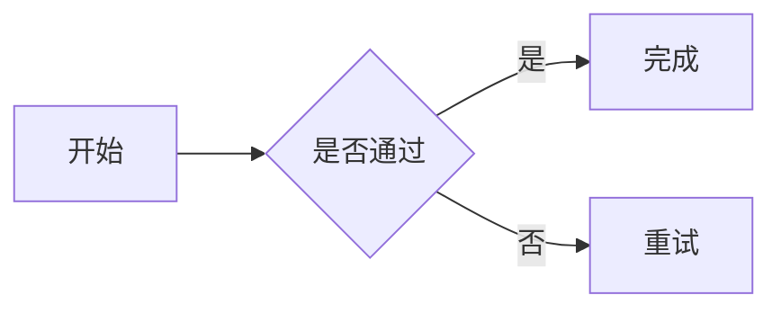

# Gemini CLI

支持 PostgreSQL 历史记录、Google Search、多轮对话、附件和 Markdown 展示的 Gemini 终端客户端。

## 安装

需要 Python 3.10+、PostgreSQL，以及 Gemini API Key。

```bash
uv sync --extra dev
cp .env.example .env
```

编辑 `.env`，至少填写：

```dotenv
GEMINI_API_KEY=你的密钥
PYCLI_DB_PASSWORD=数据库密码
```

`GEMINI_BASE_URL` 留空时连接 Google 官方 API；也可以设置为兼容 Gemini 原生 API 的中转站地址。

## 运行

```bash
uv run gemini-cli
```

输入采用 Markdown。Enter 插入换行，Esc+Enter 发送，方向键、Home 和 End 可移动光标。

完整回复和历史记录中的 `mermaid` 代码块会在本地渲染为带节点、连线和箭头的终端字符图。
例如：

````markdown

````

无法解析或超出终端宽度的图会提示原因并保留源码。数据库和 Markdown 导出保留原始 Mermaid 内容。

## 命令

```text
/system <内容>
/websearch on|off
/file --base64 <字符串> --type <.png|image/png 等>
/resume
/resume <id>
/resume last
/new
/model <模型名>
/save
/help
```

附件只暂存在内存中，用于下一次对话，成功发送后清空，不写入数据库。

## 配置

所有配置都可以通过环境变量或当前目录的 `.env` 设置，完整列表见 `.env.example`。

## 测试

```bash
uv run pytest
```
